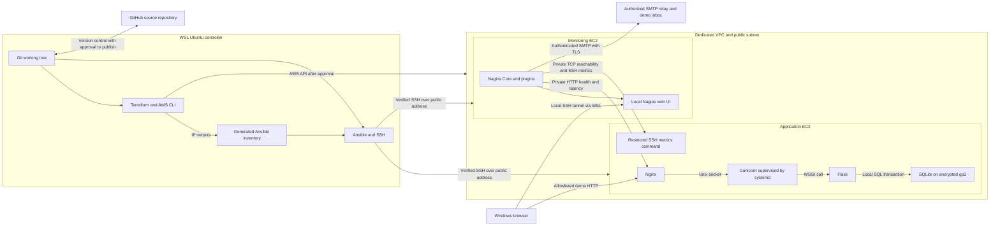
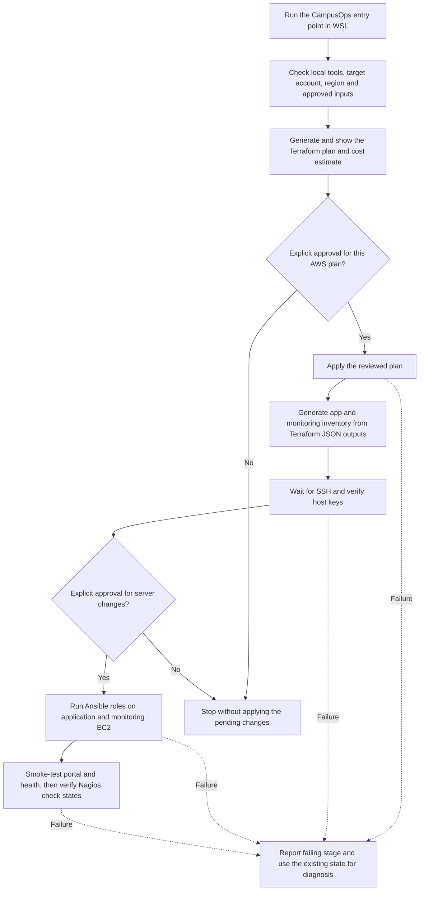

# CampusOps architecture

CampusOps uses two servers to keep application hosting and monitoring independent. The deployment design covers automated provisioning and configuration, email alerts, and documented failure recovery. The reference deployment is a single-AZ AWS lab with two Ubuntu EC2 instances in a dedicated public subnet. The same host roles can be rehearsed on local VMs if account eligibility or credits block the AWS demo.

## System architecture



### Placement and responsibilities

| Location | Components and responsibilities |
| --- | --- |
| Windows | Editor, browser, and presentation tools. The browser reaches the allowlisted demo app and the local end of the Nagios tunnel. |
| WSL Ubuntu | Git, Bash, local Python and tests, AWS CLI, Terraform, Ansible control node, SSH client, generated inventory, and protected single-operator local Terraform state. |
| App EC2 | Ubuntu, Nginx, Gunicorn under systemd, Flask and its dependencies, SQLite on EBS, and a restricted SSH metrics identity. |
| Monitoring EC2 | Ubuntu, Nagios Core, check plugins, local Nagios web UI, and an authenticated SMTP submission client. |
| GitHub | Approved source and documentation. Hosts receive the selected revision from WSL. They need no GitHub credentials. |

### Registration request

1. The browser fetches the event list or detail page. Nginx receives HTTP and proxies Flask requests through a Unix socket with permissions shared by Nginx and the app service.
2. Gunicorn accepts the proxied request and invokes Flask via WSGI. Flask looks up the event, renders the form, and verifies the event ID, inputs, and CSRF token on submission.
3. Flask opens SQLite in its persistent data directory, inserts the normalized registration using bound parameters, and commits. SQLite enforces the unique event-and-email key at write time. This protects against two simultaneous submissions that pass application validation.
4. Flask redirects to confirmation only after the commit succeeds. Gunicorn returns the response through Nginx. A refresh loads the confirmation page. Keep the SQLite file outside the deployed release directory.

The health request takes the same Nginx-to-Flask path and reads the initialized database schema. A database failure yields HTTP 503 when Flask can answer. If Gunicorn is down, Nginx can return 502 or another non-success response. Either outcome fails the Nagios health check.

### Network and access

Terraform creates a VPC, a public subnet, an internet gateway, a route table with a default IPv4 route to the gateway, and a subnet association. Each instance gets an automatically assigned public IPv4 address and a private IPv4 address. The public address lets the approved browser or WSL controller reach the instance from outside the VPC. The private address stays on the VPC path and is the target for monitoring. Public IPs can change after a stop/start. Refresh Terraform's view with a reviewed workflow before regenerating inventory when addresses change. [EC2 stop/start](https://docs.aws.amazon.com/AWSEC2/latest/UserGuide/Stop_Start.html)

| Destination | Source | Allowed inbound connection |
| --- | --- | --- |
| App security group | Operator public IPv4 `/32` or explicitly approved admin CIDR | TCP 22 for Ansible and operator SSH |
| App security group | Approved demo viewer CIDR | TCP 80 for synthetic-data demo traffic |
| App security group | Monitoring security group | TCP 80 for private health and latency, TCP 22 for reachability and restricted metrics |
| Monitoring security group | Operator public IPv4 `/32` or explicitly approved admin CIDR | TCP 22 for Ansible and an SSH tunnel to the loopback Nagios UI |

Security groups are stateful. Replies to permitted traffic can return automatically. A security group source identifies the monitoring instances for private traffic. The monitoring key uses a separate unprivileged account and a forced read-only metrics command, with forwarding and interactive access disabled for that account. Ansible verifies host keys and escalates only tasks that need it. Restrict egress to needed paths where practical, including package updates, DNS, the monitoring paths, and authenticated SMTP submission on TCP 587 from the monitoring host. Gunicorn, SQLite, and the Nagios UI have no direct public listeners. Any future public or real-data demo requires approved HTTPS configuration. [AWS security group rules](https://docs.aws.amazon.com/vpc/latest/userguide/security-group-rules.html)

## Deployment workflow



Terraform's AWS provider reads current resources during planning and builds a dependency graph. A successful apply records resource identities in state. The inventory generator uses `terraform output -json` and validates the named outputs before writing a local ignored file. It sets `ansible_host` for each group from the corresponding public address and passes the app's private address separately for the monitoring role. SSH readiness is a bounded wait with host key verification. A partial failure is diagnosed using current state and logs before any separately approved repair. [Terraform plan](https://developer.hashicorp.com/terraform/cli/commands/plan)

Ansible connects over SSH, runs modules on the managed hosts, installs dependencies, transfers the app revision, and renders templates for Nginx, systemd, and Nagios. Handlers reload services when their inputs change. A successful check of an unchanged configuration ordinarily needs no restart. The shell workflow writes no commits and performs no GitHub publication.

### Detection, notification, and recovery

Nagios runs scheduled plugins against the app's private address. Use TCP reachability, HTTP health, a custom latency check, and SSH metrics for sampled CPU utilization, available memory, and disk use on the database filesystem. Plugin exit codes communicate `OK`, `WARNING`, `CRITICAL`, and `UNKNOWN`. Use check retries to turn a transient soft error into a hard state only after repeated failure. The Nagios contact receives a problem email and a recovery email through the authorized relay. [Nagios state types](https://assets.nagios.com/downloads/nagioscore/docs/nagioscore/4/en/statetypes.html)

For the demo, obtain approval to stop Gunicorn while leaving Nginx and Nagios running. The operator inspects the Nagios history, the HTTP response, and systemd logs, then reruns the approved Ansible configuration to restore the service. Verify health, an existing registration, a new registration, and the recovery email. Use [the acceptance checklist](acceptance-tests.md) to capture timestamps.

## CampusOps concepts

| Concept | What it means in this project |
| --- | --- |
| DevOps | Development and operations share a repeatable delivery and feedback process. A change to the registration portal goes through tests, a controlled deployment, and checks that tell the operator whether the release is healthy. |
| Infrastructure as Code | Declare infrastructure in reviewable configuration. Terraform compares that configuration with existing resources tracked through its state and plans actions. For example, a new SSH allowlist appears in the plan before AWS changes. |
| Configuration management | Declare how a server should be configured and converge it to that state. Ansible installs Nginx, supplies a known configuration, and makes sure the Gunicorn service is running. |
| Terraform and Ansible together | Terraform owns AWS resources and knows where the hosts are. Ansible owns software and service configuration and uses those addresses to connect. Changing a Flask dependency does not require replacing an instance. |
| Continuous monitoring | Checks run periodically even when nobody is watching. Nagios records repeated HTTP failures, raises a confirmed incident, and checks for recovery after the operator restores Gunicorn. |
| EC2 communication | Subnet routes determine where packets can go and security groups determine which connections are allowed. Nagios reaches the app's private IPv4 in the VPC. WSL reaches the public management address through an allowlisted SSH rule. |
| Nginx, Gunicorn, and systemd | Nginx handles the incoming HTTP connection, Gunicorn runs workers that call Flask, and systemd starts and supervises the Gunicorn service. The service's logs and state help diagnose an Nginx 502. |
| Idempotency | Reapplying the same desired configuration should converge to the same result. On an unchanged second run Ansible should report no changes. When the desired service is stopped, an approved rerun can start it without rewriting unrelated settings. |

## AWS Free Tier and cost plan

Two short-lived EC2 instances are a reasonable lab design **if** your account permits the selected region and configuration and has enough eligible credit for the expected runtime. We have not verified your account balance or eligibility. AWS lists `t3.micro`, `t4g.micro`, and gp3 among eligible configurations, but eligibility does not mean unmetered usage. Check the AMI as well. The AWS Free plan commonly ends after six months or when its credits run out, whichever comes first. A Paid plan can bill costs beyond or outside applicable credits. Confirm the plan, credit terms, and expiry in your account before selecting a launch date. [AWS Free Tier FAQs](https://aws.amazon.com/free/free-tier-faqs/) · [EC2 eligibility](https://docs.aws.amazon.com/AWSEC2/latest/UserGuide/ec2-free-tier-usage.html)

**Sizing.** Start with two `t3.micro` instances (2 vCPUs, 1 GiB RAM each) for x86-64 compatibility, a standard Ubuntu LTS AMI with no software surcharge, and one encrypted 10 GiB gp3 root volume per instance at baseline IOPS and throughput, subject to the chosen AMI's minimum size. Use Standard CPU credit mode to avoid Unlimited-mode surplus CPU charges and watch for throttling during rehearsal. An eligible `t4g.micro` is a potential lower-cost Arm alternative if the AMI, packages, and plugins are verified on Arm. Check both prices in the selected region. [EC2 T3](https://aws.amazon.com/ec2/instance-types/t3/) · [EC2 T4g](https://aws.amazon.com/ec2/instance-types/t4/) · [EBS pricing](https://aws.amazon.com/ebs/pricing/)

| Meter or component | Treatment in this design |
| --- | --- |
| EC2 Linux compute | Metered while running. Verify instance and AMI eligibility and any software charges. |
| Two public IPv4 addresses | Metered at $0.005 per address-hour at public rates. No Elastic IPs are planned. |
| Encrypted gp3 volumes | Metered by provisioned size and retention time. Baseline performance is included in the volume price. Stopped instances retain EBS storage. |
| Basic VPC, subnet, route table, internet gateway, security groups, and EC2 public-key registration | No separate hourly infrastructure charge is included for these building blocks. Data transfer and public addresses can be charged. |
| Optional or external costs | Snapshots, internet transfer, additional monitoring features, and an SMTP relay can cost extra or have eligibility limits. Use the approved relay's own price terms. |
| Excluded services | NAT gateways, load balancers, managed databases, reserved capacity, and Marketplace images with licensing fees are outside the baseline. |

**Illustrative public rates in Northern Virginia (`us-east-1`).** Two Linux `t3.micro` instances at $0.0104/hour, two public IPv4 addresses at $0.005/hour, and 20 GiB total gp3 at $0.08/GiB-month give about **$24.08 for a 730-hour month**. If all resources exist for 48 hours and the volumes are deleted with the hosts, the same baseline is about **$1.59** using a 30-day storage month. Figures are in USD before credits, taxes, transfer, relay fees, and extras. Reprice in the chosen region, for example Mumbai (`ap-south-1`) if available and selected. The reference region is an estimate input, not a deployment decision. [EC2 T3 pricing](https://aws.amazon.com/ec2/instance-types/t3/) · [VPC and IPv4 pricing](https://aws.amazon.com/vpc/pricing/) · [EBS pricing](https://aws.amazon.com/ebs/pricing/) · [AWS Pricing Calculator](https://calculator.aws/)

**Check the account before launch.**

1. Open AWS Console Home and inspect the Cost and Usage widget or AWS Settings for the current plan, remaining credits, and days remaining. For earlier accounts, use **Billing and Cost Management → Credits** to see each credit and its expiry. Review the terms of any separate promotion.
2. In **Billing and Cost Management → Free Tier**, inspect usage and allowances where available. Check **Bills** for EC2, EBS, IPv4, and transfer by region. Verify the instance type and AMI eligibility in the selected region and confirm credit coverage against the estimate.
3. With approval and if available to your account, use **AWS Budgets** to set a notification-only monthly budget. For a short demo, start with a proposed $5 gross usage budget using actual-cost emails at 50%, 80%, and 100%. Exclude credits from that gross view where the settings allow it, and track remaining credits separately. Budget data can be delayed and alerts do not stop resources. Notification-only budget monitoring is free under AWS's published pricing. [AWS billing settings](https://docs.aws.amazon.com/accounts/latest/reference/view-billing-information.html) · [AWS Budgets pricing](https://aws.amazon.com/aws-cost-management/aws-budgets/pricing/) · [Budget timing](https://docs.aws.amazon.com/cost-management/latest/userguide/budgets-managing-costs.html)

**Teardown strategy.** After collecting demo evidence, export any data that needs retaining and verify the backup can be restored. Confirm the AWS identity, region, project tags, and Terraform state. Generate a saved destroy plan with `terraform plan -destroy -out=...` and inspect it with `terraform show`. Present the exact removals, data loss, and expected retained charges for separate explicit approval. Apply only the approved destroy plan. Confirm the two instances, root volumes, public IP allocations, and project network are removed. Check for separately created snapshots or other retained assets before closing the lab and review Billing again after it updates. Budget settings and separately managed resources require their own approval to change. Finish before the plan expires. [Terraform destroy workflow](https://developer.hashicorp.com/terraform/cli/commands/destroy)

## Repository organization

This is the target repository layout. Directories are added as their components are implemented.

```text
CampusOps-DevOps-Automation/
├── .gitignore
├── README.md                         # Project overview and local setup
├── app/                              # Flask package, templates, static assets, schema
├── infra/                            # Terraform configuration and provider lock file
├── ansible/                          # Inventory example, playbooks, and role folders
├── scripts/                          # Deployment entry point and inventory generator
├── tests/                            # App tests and deployment helper tests
└── docs/                             # Phase 1 specs, future runbooks, and test evidence
    ├── requirements.md
    ├── architecture.md
    └── acceptance-tests.md
```

Use descriptive lowercase names. Prefer snake_case for Python modules and hyphenated names for documentation. Use `app` and `monitoring` consistently as host group names. Keep state, plans, credentials, generated inventory, synthetic registration databases, and private reference documents outside Git tracking.

## Decisions to finalize before the corresponding phase

| Decision | Proposed baseline and resolution |
| --- | --- |
| AWS region, account budget, and AMI | Select after an account eligibility check and regional estimate. Record the concrete instance sizes, AMI IDs, allowed CIDRs, and credit headroom in the approval summary. |
| SSH host identity bootstrap | Verify fingerprints through an independent trusted source such as EC2 console output when the image provides them. Confirm the method before the first SSH deployment. |
| SMTP relay and authorized inbox | Choose a provider, check its cost and terms, verify the sender and recipient if required, and confirm the relay path from EC2 before the monitoring demo. |
| Resource and latency thresholds | Keep the HTTP detection target from the requirements. Choose CPU, disk, memory, and latency warning/critical thresholds after measuring the idle and normal-load baseline. |
| Public access and production capacity | The planned controlled demo uses synthetic data and a CIDR allowlist. A public launch, real attendee data, or stronger availability targets would need a separate review. |
