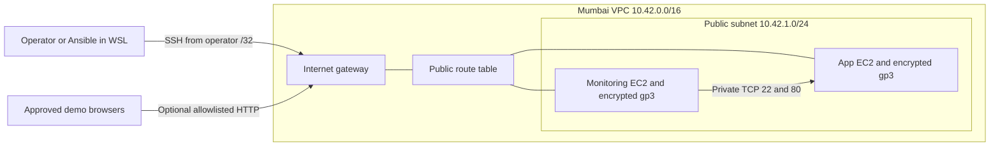
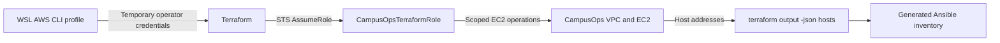

# CampusOps infrastructure

Terraform describes two Ubuntu EC2 hosts in one public subnet in Mumbai (`ap-south-1`). This directory is prepared for plan review. Apply and destroy require separate approvals. The application and monitoring services are configured in later milestones.

## Files

| File | Responsibility |
| --- | --- |
| `versions.tf`, `.terraform.lock.hcl` | Select supported Terraform and AWS provider versions and record the installed provider and checksums. |
| `providers.tf` | Uses the WSL `campusops-operator` profile to assume `CampusOpsTerraformRole`. Restricts provider operations to the supplied account and Mumbai. |
| `network.tf`, `security.tf` | Create the VPC, public subnet, routing, security groups, and standalone IPv4 rules. |
| `main.tf` | Checks the pinned AMI, imports the public SSH key, and defines the two instances. |
| `variables.tf`, `terraform.tfvars.example` | Define and document inputs. The example contains placeholders. |
| `outputs.tf` | Exposes public and private host addresses plus network identifiers for later inventory generation. |
| [IAM policy drafts](iam/README.md) | Defines the proposed role trust, role permissions, and operator permission. They are outside the Terraform configuration. |

## Expected inventory

| Quantity | Managed resource |
| --- | --- |
| 1 each | VPC `10.42.0.0/16`, public subnet `10.42.1.0/24`, internet gateway, public route table, default IPv4 route, subnet association |
| 2 | Security groups, named `campusops-app` and `campusops-monitoring` |
| 9 plus one per approved demo CIDR | Standalone security group rules |
| 1 | Imported Ed25519 SSH public key `campusops-operator` |
| 2 | Linux On-Demand `t3.micro` instances with Standard CPU credits, IMDSv2 required, and automatically assigned public IPv4 addresses |

EC2 creates an interface and an encrypted 10 GiB gp3 root volume per instance. The volumes use baseline performance and are deleted when their instances terminate. On VPC creation AWS also supplies a main route table, default security group, and default network ACL. The project uses its own subnet route table and host security groups. The IAM bootstrap is a separate review.

### Network rules

| Direction | Host | Source or destination | TCP ports |
| --- | --- | --- | --- |
| Ingress | App and monitoring | Approved operator IPv4 /32 | 22 |
| Ingress | App | Monitoring security group | 22, 80 |
| Ingress | App | Optional demo CIDRs, /24 or narrower | 80 |
| Egress | App and monitoring | IPv4 internet destinations for package repositories and web traffic | 80, 443 |
| Egress | Monitoring | App security group | 22 |

The monitoring HTTP probe uses the TCP 80 egress rule and the app's private IP. Security groups allow response traffic through their connection tracking. The AWS-provided DNS resolver does not need a security group rule. Browser HTTP access is closed until demo CIDRs are configured, and the monitoring UI has no direct inbound HTTP rule. Review SMTP egress separately when the relay is known. Use synthetic data for HTTP demos.

A stop/start generally changes an automatically assigned public IPv4 address. The primary private address is retained when the same instance restarts. EBS stays attached on stop. For the later inventory workflow, refresh Terraform state through an approved operation before regenerating inventory from `terraform output -json hosts`, which reads stored state. Verify host fingerprints before reconnecting. Replacement can change both addresses and delete the old root volume. [EC2 stop and start behavior](https://docs.aws.amazon.com/AWSEC2/latest/UserGuide/Stop_Start.html)

## Cost and review checklist

The Mumbai estimate is **$1.68 for 48 hours** or **$25.48 for a 730-hour month** before credits, tax, and extras. It uses $0.0112 per instance-hour, $0.005 per public IPv4 address-hour, and $0.0912 per GB-month for 20 GiB total gp3. The short estimate assumes the volumes are removed after 48 hours and prorates storage over 30 days. Stopping ends compute charges while attached EBS continues to accrue storage charges. Snapshot and transfer charges depend on usage and available allowances. [Mumbai EC2 and EBS price list](https://pricing.us-east-1.amazonaws.com/offers/v1.0/aws/AmazonEC2/current/ap-south-1/index.csv) · [IPv4 pricing](https://aws.amazon.com/vpc/pricing/)

1. Review and approve the IAM setup separately. Verify that the operator and assumed role belong to the intended account.
2. Review the exact Mumbai AMI ID, Free Plan eligibility, CPU architecture, publisher, and 10 GiB minimum-size compatibility. The AMI data source checks the pinned image against Canonical's public publisher ID and Ubuntu 24.04 amd64 naming pattern. [Canonical AMI lookup](https://ubuntu.com/aws/docs/aws-how-to/instances/find-ubuntu-images/)
3. Copy the example to the ignored `terraform.tfvars`. Fill in the real account, AMI, and operator CIDR locally. Supply the path to the `.pub` file and choose any approved demo CIDRs. Check that the proposed CIDRs do not overlap a relevant operator network. Keep private keys and generated inventory out of Git.
4. Run `terraform fmt -check`, `terraform init -backend=false -input=false`, and `terraform validate` from this directory. These are local configuration checks. Initialization installs the provider without configuring a remote backend.
5. In the plan milestone, verify inputs and permission coverage, confirm the budget and intended runtime, then review the AWS-backed plan. Store saved plans and state privately. Before any apply or destroy, obtain separate explicit approval with the exact account, region, resource changes, and cost implications.
